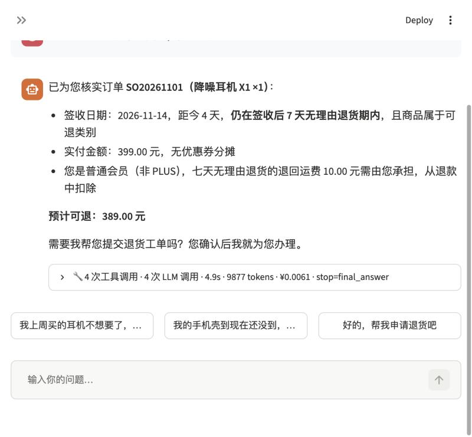
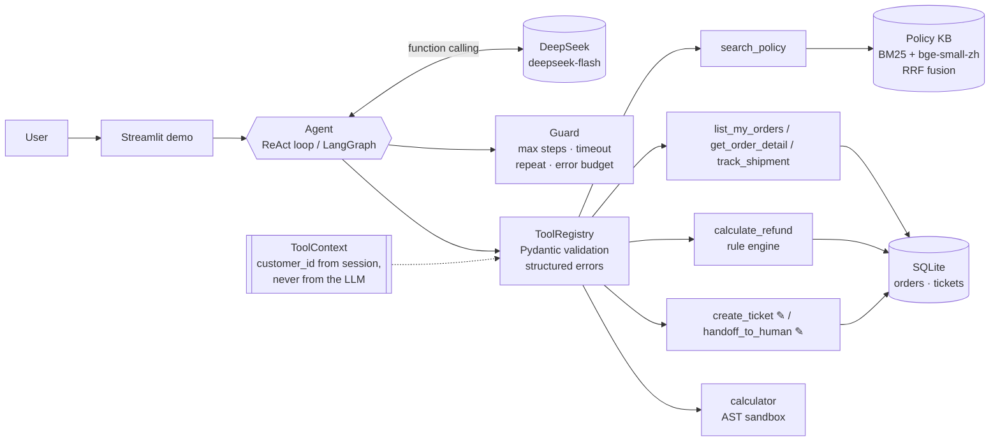
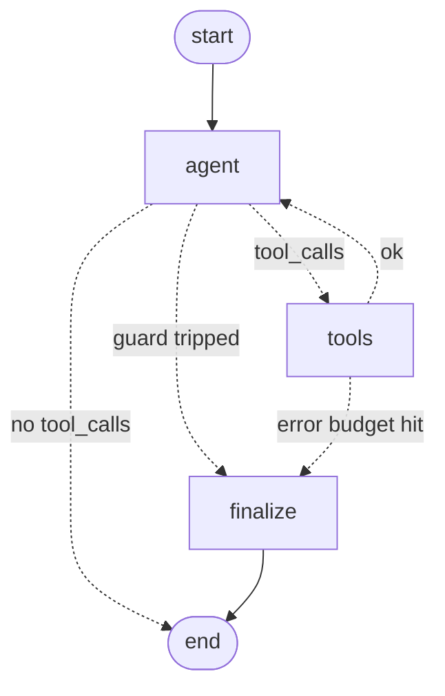

# Smart Support Agent · 电商智能客服 Agent

> **中文简介**：面向电商售后场景的 AI 客服 Agent。基于 DeepSeek Function Calling，模型自主规划多步工具调用（政策检索、订单/物流查询、退款规则引擎、建工单、转人工），用 **手写 ReAct 循环** 和 **LangGraph 状态图** 两种方式实现，含参数校验、统一错误协议、越权防护、最大步数/超时/重复调用/连续错误等终止条件，以及多轮会话记忆。配套 62 条规则判分评测集，与“纯 RAG”和“RAG + 订单数据注入”两个基线对比任务成功率、步数、延迟与成本。
>
> **English**: A customer-support agent for a (fictional) e-commerce shop. Built on DeepSeek function calling, the model plans multi-step tool use — hybrid-RAG policy search, order & shipment lookup, a deterministic refund engine, ticket creation and human hand-off — implemented twice: a **hand-written ReAct loop** and a **LangGraph state graph** with checkpointed memory. Includes schema validation, structured tool errors, IDOR protection, and stop conditions (max steps, timeout, repeated calls, consecutive errors). A 62-case rule-graded benchmark compares it with plain RAG and RAG-with-order-context on success rate, steps, latency and cost.



## Results

62 cases × 3 repeats = 186 runs per system · `deepseek-flash` · temperature 0 · run on 2026-11-18（完整数据见 [`eval/results/`](eval/results/)）

| System | Task success | Avg LLM calls | Avg tool calls | Latency P50 / P95 | Avg tokens in / out | Cost / case |
|---|---|---|---|---|---|---|
| `rag` 纯 RAG | 45.7% | 1.08 | 0 | 2.23s / 6.02s | 390 / 268 | ¥0.0027 |
| `rag_context` RAG + 订单数据注入 | 76.3% | 1.08 | 0 | 2.13s / 5.57s | 976 / 266 | ¥0.0028 |
| **`agent_loop`** 手写循环 | **100.0%** | 2.97 | 2.68 | 4.07s / 8.50s | 6470 / 470 | ¥0.0057 |
| **`agent_langgraph`** LangGraph | **99.5%** | 2.96 | 2.60 | 3.81s / 7.61s | 6511 / 449 | ¥0.0055 |

按类别：

| System | 政策 | 订单 | 多步推理 | 业务办理 | 转人工 | 安全 | 多轮 |
|---|---|---|---|---|---|---|---|
| rag | 100% | 10% | 44% | 0% | 0% | 72% | 40% |
| rag_context | 100% | 100% | 88% | 0% | 0% | 89% | 80% |
| agent_loop | 100% | 100% | 100% | 100% | 100% | 100% | 100% |
| agent_langgraph | 100% | 100% | 100% | 95% | 100% | 100% | 100% |

**解读**

- 只看基线也能完成的 51 个问答类用例（去掉“业务办理”“转人工”），成功率：纯 RAG 55.6% → RAG + 订单注入 92.8% → Agent 100%。基线的剩余错误集中在需要组合规则的多步问题，比如延误补偿漏掉 20 元券、没有区分支付方式的到账时间。
- Agent 平均每单 2.6–2.7 次工具调用、约 3 次 LLM 调用，**延迟约为基线的 1.8 倍，成本约 2 倍（仍不到 ¥0.006/单）**。多轮 tool-calling 的前缀缓存命中率约 87%，抵消了大部分 token 增长。
- 工具调用错误率约 2.4%，全部是越权（`permission_denied`）或订单不存在（`not_found`）这类预期中的业务错误；出现工具错误的 18 次运行全部正确恢复，没有一次触发异常终止条件。
- 两种实现效果基本一致。LangGraph 版唯一的一次失败：A06（增值税专票）3 次中有 1 次只给了说明、没有建工单。

**局限**：用例和种子数据由作者编写，规模小（62 条），场景是虚构商城，100% 不代表真实线上表现；判分是规则匹配，可能漏判表述不同但正确的答案（对基线更不利）。可以把这套评测框架用在更难、更真实的数据上继续扩展。

## Architecture



LangGraph state graph（`src/support_agent/agents/graph_agent.py`，由 `graph.get_graph().draw_mermaid()` 导出）:



### Agent design highlights

| 能力 | 实现 |
|---|---|
| 工具调用循环 | `ReActAgent`：LLM → tool_calls → 执行 → 观察 → 循环，支持一步并行多个工具；`GraphAgent`：同逻辑的 LangGraph `StateGraph`（agent / tools / finalize 三节点 + 条件边） |
| 工具 Schema | Pydantic 模型自动生成 OpenAI function schema（枚举、正则 `^SO\d{8}$`、长度/范围约束、字段说明） |
| 参数校验与异常 | 非法 JSON / 参数校验失败 / 未知工具 / 业务异常 / 工具崩溃 → 统一 `{"ok": false, "error": {type, message, hint}}` 回传给模型自我修正，循环永不崩溃 |
| 终止条件 | 模型不再调用工具；最大步数；墙钟超时；相同调用重复 >2 次；连续 3 次工具错误 → 关闭工具（`tool_choice="none"`）强制给出最终答复 |
| 安全 | `customer_id` 由会话注入而非模型参数，防 Prompt 注入越权（IDOR）；写操作工具幂等（同订单同类工单不重复创建）；计算器用 AST 白名单沙箱 |
| 确定性 | 退款金额由规则引擎计算（优惠券按比例分摊、运费扣除、PLUS 免运费、延误补偿），Prompt 约束模型不得自行计算 |
| 记忆 | LangGraph `InMemorySaver` checkpointer 按 `thread_id` 保存会话；手写版保留用户轮次与最终答复、丢弃工具中间消息以节省 token |
| 可观测性 | 每次运行记录 LLM 调用次数、工具调用轨迹与耗时、token（含缓存命中）、成本、停止原因 |

## Evaluation

- **数据**：虚构商城的 5 个用户、11 个订单（手写种子数据，覆盖 PLUS 会员、优惠券分摊、生鲜/定制/虚拟商品、签收第 7 天边界、物流延误、超 30 天等情形）+ 8 篇政策文档。模拟“今天”固定为 2026-11-18，保证可复现。
- **用例**：`eval/build_cases.py` → `eval/cases.jsonl`，62 条，7 类：政策问答 14 / 订单查询 10 / 多步推理 16 / 业务办理 7 / 转人工 4 / 安全（越权、注入、越界）6 / 多轮 5。
- **判分**：全部规则判分，不用 LLM 当裁判——答案关键词与金额（±0.01）、禁止泄露内容、必须调用的工具、数据库副作用（工单是否创建、类别与订单是否正确、是否转人工）。每个用例在独立的内存数据库中运行。
- **对比系统**：
  - `rag`：检索政策 + 单次生成（典型 FAQ 机器人）
  - `rag_context`：检索政策 + 把该用户**全部订单与物流数据**塞进 Prompt（强基线：事实与 Agent 相同，但没有工具、不能办理业务）
  - `agent_loop`：手写 Function Calling 循环
  - `agent_langgraph`：LangGraph 状态图
- **成本口径**：按 DeepSeek 官方 `deepseek-flash` 高峰时段价格（缓存命中 0.04 / 未命中 2 / 输出 8 元每百万 token）计算，空闲时段为一半。

复现：

```bash
python eval/run_eval.py --repeats 3          # 全量
python eval/run_eval.py --only M05 A01       # 指定用例
```

结果写入 `eval/results/summary.md`、`summary.json` 和逐条记录 `runs.jsonl`（含每次回答、工具轨迹、失败原因）。

## Quick start

```bash
git clone https://github.com/iixuo/smart-support-agent.git && cd smart-support-agent
python3 -m venv .venv && source .venv/bin/activate
pip install -r requirements.txt && pip install -e .
cp .env.example .env            # 填入 DEEPSEEK_API_KEY（.env 已在 .gitignore 中）
pytest -q                       # 20 个离线单测（FakeLLM，无需 Key）
streamlit run app/streamlit_app.py
```

首次运行会从 Hugging Face 下载 `BAAI/bge-small-zh-v1.5`（约 100MB）；下载失败时自动退化为 BM25 检索。

## Project layout

```
src/support_agent/
  config.py            # .env 配置、定价、模拟日期
  llm.py               # DeepSeek(OpenAI 兼容) 客户端 + FakeLLM
  db.py                # SQLite 模拟业务库与种子数据
  retriever.py         # BM25 + bge-small-zh 混合检索，RRF 融合
  tools/base.py        # Tool / ToolRegistry：schema 生成、校验、统一错误
  tools/business.py    # 8 个业务工具与退款规则引擎
  agents/core.py       # RunResult 追踪、Guard 终止条件、工具执行
  agents/react_loop.py # 手写 ReAct / Function Calling 循环
  agents/graph_agent.py# LangGraph 状态图 + checkpointer 记忆
  agents/rag_baseline.py
data/policies/*.md     # 政策知识库（虚构）
eval/                  # 用例、评测脚本、结果
app/streamlit_app.py   # Demo：对话 + 工具调用轨迹
tests/                 # pytest：工具、终止条件、自我纠错、记忆、判分器
```

## Notes

「星河优选」及全部订单、政策均为虚构，仅用于演示。
